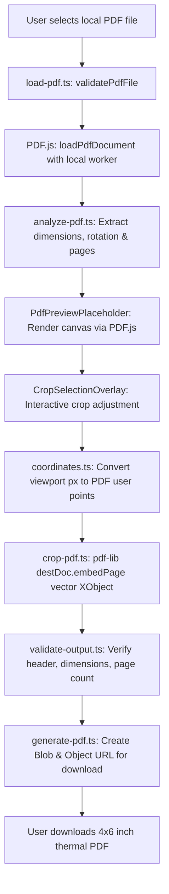

# Phase 1: Real Browser-Only PDF Processing Engine

This document details the architecture, coordinate mathematics, vector-preserving export pipeline, worker configuration, and privacy design implemented in **Phase 1** of ShipCrop Studio.

---

## 1. Overview & Architecture

ShipCrop Studio Phase 1 replaces the simulated interaction states of Phase 0 with a genuine, production-grade, browser-only PDF processing engine.



### Core Technologies
1. **`pdfjs-dist` (v6.4.299)**: High-fidelity document parsing, metadata extraction, viewport transformations, and `<canvas>` page rendering.
2. **`pdf-lib` (v1.17.1)**: Pure JavaScript vector manipulation, page embedding (`embedPage`), and PDF generation.
3. **TypeScript & React 19**: Strictly typed contracts, declarative job lifecycle states, and responsive UI interactions.

---

## 2. Browser-Only Data Flow & Zero-Network Privacy

All PDF processing operates **exclusively in local browser memory**:
- **No Remote Transmission**: Neither source PDF bytes, cropped label coordinates, tracking numbers, nor generated documents are sent to any server endpoint, cloud bucket, or external service.
- **Local Worker Execution**: The PDF.js web worker is bundled directly into the public directory at `/pdf.worker.min.mjs` matching the exact installed `pdfjs-dist` version. It loads from the local browser origin (`self.location.origin`), requiring zero CDN fetches or third-party connections.
- **Resource Lifecycle Management**:
  - `loadPdfDocument` returns a handle with `.destroy()` calling `PDFDocumentProxy.cleanup()` to free memory when switching or removing files.
  - Render tasks maintain `RenderTask` references and invoke `.cancel()` if the user rapidly switches pages or zoom levels.
  - Generated Blob URLs are tracked in ref cells and released with `URL.revokeObjectURL()` upon workspace reset or subsequent file processing.
  - Ephemeral state: All data is purged upon tab refresh or workspace clearance.

---

## 3. Coordinate Systems & Mathematical Transformations

A primary challenge in PDF manipulation is mapping between visual screen pixels and PDF user-space points.

### Coordinate Systems Compared
| Feature | Screen / Viewport Space | PDF User Space |
| :--- | :--- | :--- |
| **Origin `(0, 0)`** | Top-Left corner of canvas | Bottom-Left corner of MediaBox |
| **Y-Axis Direction** | Increases **downward** | Increases **upward** |
| **Units** | Device CSS Pixels | PDF Points ($1\text{ pt} = \frac{1}{72}\text{ inch}$) |
| **Transformations** | Zoom factor, CSS scale | Rotation (0°, 90°, 180°, 270°), MediaBox offsets |

### Viewport to PDF Point Mapping (`coordinates.ts`)
Rather than relying on naive percentage multipliers, `coordinates.ts` delegates to PDF.js's native transformation matrix via `viewport.convertToPdfPoint(x, y)`:

```typescript
// Sample all 4 corners to handle any rotation (0, 90, 180, 270 deg)
const p1 = viewport.convertToPdfPoint(x, y);
const p2 = viewport.convertToPdfPoint(x + width, y);
const p3 = viewport.convertToPdfPoint(x, y + height);
const p4 = viewport.convertToPdfPoint(x + width, y + height);

const left = Math.min(p1[0], p2[0], p3[0], p4[0]);
const right = Math.max(p1[0], p2[0], p3[0], p4[0]);
const bottom = Math.min(p1[1], p2[1], p3[1], p4[1]);
const top = Math.max(p1[1], p2[1], p3[1], p4[1]);
```

### Inverse Mapping (`pdfCropToViewport`)
When the user adjusts zoom (e.g. from 100% to 150%), `pdfCropToViewport` recalculates the visual canvas coordinates using `viewport.convertToViewportPoint()`. This ensures the visual crop overlay stays anchored to the exact same physical region on the document regardless of zoom scale.

---

## 4. Vector-Preserving Cropping Pipeline (`crop-pdf.ts`)

### Why Vector Embedding Instead of CropBox Rewriting
Modifying only the source page's `/CropBox` or `/MediaBox` has serious flaws:
1. It does not resize the physical page to thermal 4×6-inch dimensions.
2. Many thermal printer drivers ignore `/CropBox` and print the entire unclipped `/MediaBox`.
3. Rasterizing the page to an image causes blurry text and unreadable 1D/2D barcodes on 203 DPI thermal heads.

### The `embedPage` Solution
ShipCrop Studio creates a brand new PDF document (`PDFDocument.create()`) and embeds the selected source page region as a vector Form XObject:

```typescript
// 1. Embed the user-specified bounding box directly from the source page
const embedded = await destDoc.embedPage(srcPage, {
  left: options.cropBox.left,
  bottom: options.cropBox.bottom,
  right: options.cropBox.right,
  top: options.cropBox.top,
});

// 2. Create target page with exact physical dimensions (4x6" = 288x432 pt)
const destPage = destDoc.addPage([targetWidthPt, targetHeightPt]);

// 3. Calculate uniform aspect-ratio preserving fit (no distortion)
const fit = calculateAspectFit(embedded.width, embedded.height, targetWidthPt, targetHeightPt, marginPt);

// 4. Draw embedded vector object onto destination page
destPage.drawPage(embedded, {
  x: fit.x,
  y: fit.y,
  width: fit.width,
  height: fit.height,
});
```

### Aspect Ratio & Distortion Prevention (`calculateAspectFit`)
To avoid non-uniform stretching:
$$\text{scale} = \min\left(\frac{W_{\text{avail}}}{W_{\text{crop}}}, \frac{H_{\text{avail}}}{H_{\text{crop}}}\right)$$
The cropped region is scaled strictly uniformly and centered within the target printable area, honoring user-configured safety margins (0–5 mm).

---

## 5. Output Verification (`validate-output.ts`)

Before reporting success to the user, `validateGeneratedPdf` inspects the output bytes:
1. **Header Inspection**: Confirms the `%PDF-` signature is present.
2. **Byte Length**: Rejects payloads under 300 bytes as corrupt or empty.
3. **Parse Integrity**: Loads the output bytes via `PDFDocument.load()` to confirm structure validity.
4. **Dimension Verification**: Confirms generated page dimensions match the requested output format (288×432 pt for 4×6" portrait or 432×288 pt for landscape).
5. **Page Count Integrity**: Asserts output pages meet or exceed expected minimum count.

---

## 6. Job State Machine & Error Handling

The processing lifecycle is governed by an explicit `JobStatus` state machine:

| State | Description | UI Representation |
| :--- | :--- | :--- |
| `queued` | Initial idle state awaiting user file selection. | File dropzone ready |
| `validating` | Inspecting `%PDF-` signature and file size. | Processing badge |
| `analyzing` | Extracting page count, dimensions, and rotation. | Analysis spinner |
| `preview-ready` | First page rendered on `<canvas>`; crop overlay active. | Interactive workspace |
| `processing` | Vector embedding and target page assembly via `pdf-lib`. | Vector embedding indicator |
| `validating-output` | Re-parsing output bytes to guarantee integrity. | Validation indicator |
| `completed` | Output PDF verified; ready for download. | Results panel with metrics |
| `failed` | Error encountered with recovery button. | Error alert with Retry action |

---

## 7. Automated Test Suite

A comprehensive test suite of **28 automated tests** validates the engine:

### 1. Coordinate Engine Tests (`tests/coordinates.test.ts`)
- `validateCropBoundingBox`: Valid positive boxes, zero/negative width, zero/negative height, sub-minimum sizes (<20 pt), page bounds checking.
- `clampViewportRect`: In-bounds rectangles, minimum dimension constraints, negative coordinates, canvas boundary clamping.
- `viewportToPdfCrop` & `pdfCropToViewport`: Standard 0° orientation, 90° rotated viewports, round-trip invariant conversion.

### 2. Validation Engine Tests (`tests/validation.test.ts`)
- Genuine `%PDF-1.7` signatures accepted.
- Empty files (0 bytes) rejected.
- Non-PDF files (e.g. HTML disguised with `.pdf` extension) rejected.
- Files exceeding maximum configured size limits rejected.
- Normal files within size limits accepted.

### 3. Crop Engine & Thermal Export Tests (`tests/crop-engine.test.ts`)
- `calculateAspectFit`: Portrait 4×6" uniform scaling, margin preservation, aspect ratio invariance.
- `cropPdfDocument`: Real vector embedding using `tests/fixtures/synthetic-test-labels.pdf`, target 288×432 pt page sizing, selective single-page processing, landscape crop orientation.
- `validateGeneratedPdf`: Corrupted byte rejection, empty buffer rejection, page count validation.

Run tests anytime with:
```bash
npm test
```

---

## 8. Explicit Boundary: Generic Manual Cropping vs. Future Marketplace Auto-Detection

| Capability | Phase 1 Status | Future Phase Scope |
| :--- | :--- | :--- |
| **Manual Crop Rectangle** | ✅ Fully Implemented | Fine-tuning & keyboard shortcuts |
| **Real PDF Rendering & Zoom** | ✅ Fully Implemented | Thumbnail filmstrip navigation |
| **4×6" Thermal Vector Output** | ✅ Fully Implemented | Additional label presets |
| **Zero-Network Processing** | ✅ Fully Implemented | Offline PWA caching |
| **Automatic Label Detection** | ❌ Not in Phase 1 | **Phase 2** (using verified seller samples) |
| **OCR & Text Extraction** | ❌ Not in Phase 1 | Phase 2/3 (barcode & SKU sorting) |
| **Invoice / Picklist Splitting** | ❌ Not in Phase 1 | Phase 3 (tax invoice separation) |
| **A4 4-in-1 Multi-Up Imposition**| ❌ Not in Phase 1 | Phase 3 (sheet imposition layout) |
