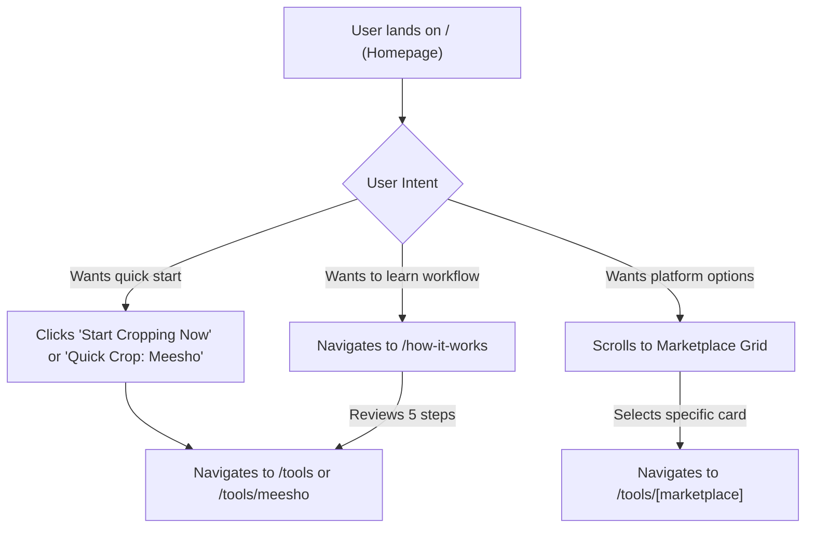
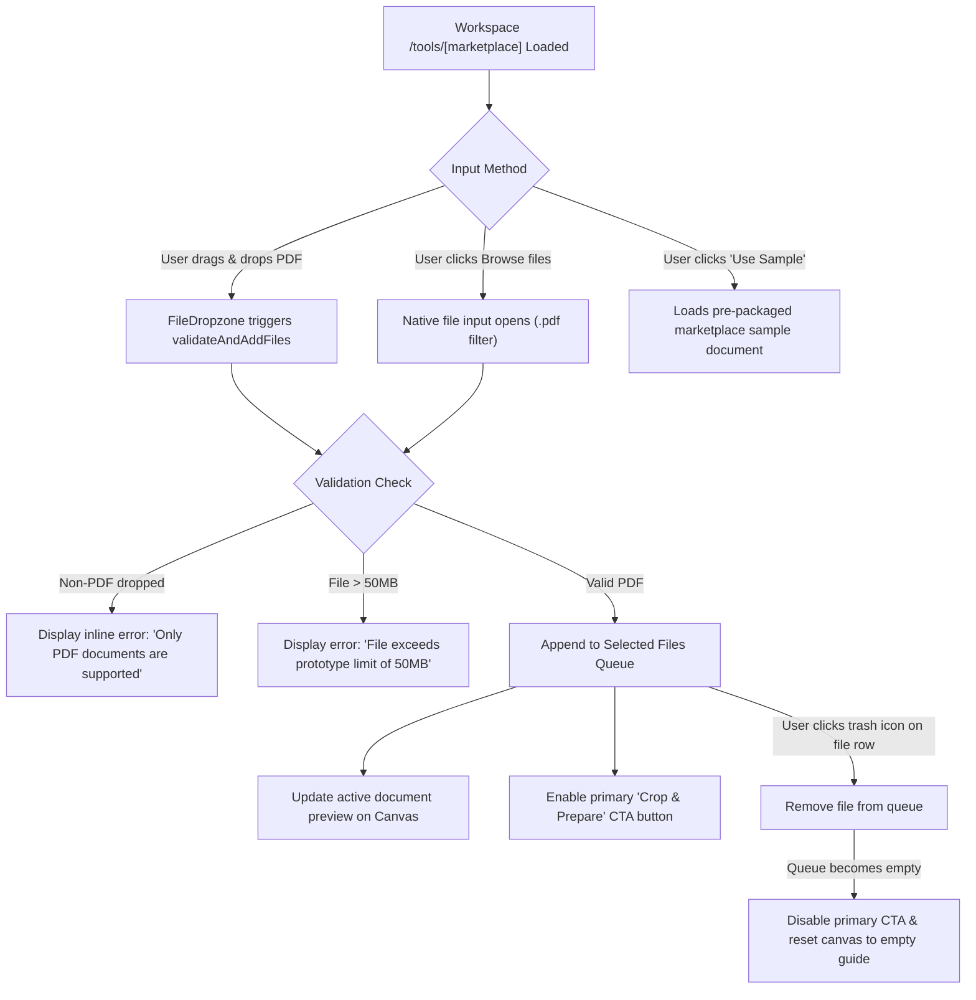
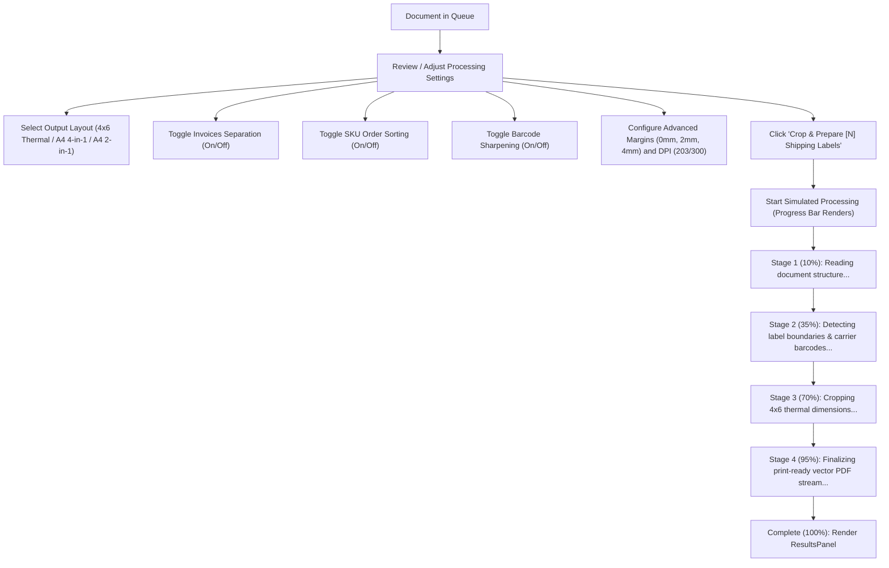

# User Flows Documentation — ShipCrop Studio

## Overview
This document outlines the user interaction paths, decision points, state transitions, and recovery mechanisms across ShipCrop Studio's Phase 0 interactive prototype.

---

## 1. Landing Page to Marketplace Journey

### Key UI Touchpoints:
- Primary CTA in Hero section ("Start Cropping Now").
- Top header direct link ("Quick Crop: Meesho").
- Responsive Marketplace Cards with direct "Open Tool" links.

---

## 2. PDF Selection Journey

---

## 3. Settings & Simulated Processing Journey

---

## 4. Success, Validation, Failure, and Reset States

### A. Success State:
- Triggered when progress reaches 100%.
- Displays:
  - Green completion badge: "Ready to Print".
  - Metric cards: Total labels count, output layout, invoice split status, SKU picklist status.
  - Primary Action: `Download Cropped Labels (PDF)` (triggers informative toast notification).
  - Secondary Action (if invoice separation enabled): `Download Tax Invoices (PDF)`.
  - Tertiary Action (if SKU sorting enabled): `Download Warehouse Picklist (PDF)`.

### B. Missing File Validation State:
- If user clicks the processing CTA while no file is loaded, an alert banner appears:
  `"Please select or upload at least one shipping label PDF to start cropping."`
- The CTA button is visibly disabled and displays: `"Select a PDF File to Crop"`.

### C. Simulated Failure & Recovery State:
- The ResultsPanel includes a testing trigger: `"Test Failure State"`.
- When clicked, it renders the `ProcessingStatus` error state:
  - Red warning icon.
  - Informative error message: `"Simulated Error: The PDF header was malformed or password-protected."`
  - Recovery button: `"Retry Simulation"` which re-runs the process seamlessly.

### D. Workspace Reset State:
- Triggered by clicking `"Reset Workspace"` in the header, `"Clear All"` in the file queue, or `"Process Another Batch"` in the results panel.
- Action clears:
  - File queue items and active file pointer.
  - Processing progress bar and results panel.
  - Validation and error messages.
  - Restores default marketplace settings (output format, margins, DPI).
